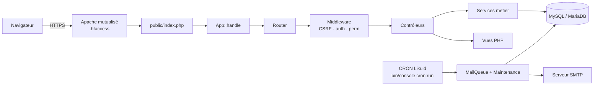

# Architecture technique

## 1. Vue d'ensemble

Monolithe modulaire PHP 8.2+, sans framework, rendu serveur (HTML + Bootstrap 5) enrichi de JavaScript natif.
Une seule application, un seul point d'entrée (`public/index.php`), une base MySQL/MariaDB, des tâches CRON.



## 2. Arborescence

```
app/
  Core/            Noyau : App, Router, Request, Response, Middleware, Session, Database,
                   Migrator, View, Validator, ErrorHandler, Logger, SecurityHeaders, helpers
  Modules/         Un dossier par domaine : contrôleur(s) + service(s) + repository éventuel
    Auth/          Connexion, réinitialisation, politique de mot de passe
    Users/         Comptes (admin) et profil personnel
    Organization/  Services et fonctions
    Roles/         Rôles et permissions
    Admin/         Tableau de bord d'administration, journal d'audit
    Dashboard/     Accueil
    Install/       Création du premier super administrateur (CLI + web)
  Services/        Services transverses : Rbac, AuditLogger, MailQueue, Mailer, Maintenance
  Views/           Gabarits PHP (layouts, partials, par module)
bin/console        Commandes : migrate, admin:create, cron:run, seed:demo
config/app.php     Configuration (lue depuis .env)
database/
  migrations/      Scripts SQL versionnés NNNN_nom.sql
  seeds/           Données de démonstration (interdites en production)
public/            Seul dossier exposé au web : index.php, .htaccess, assets/
routes/web.php     Toutes les routes et leurs contrôles d'accès
storage/           logs/, cache/, temp/, private/ (fichiers privés) — jamais exposé
tests/             Unit/, Integration/ (PHPUnit), e2e/ (Playwright)
```

**Adaptation par rapport à la structure cible :** les repositories et policies sont rangés *dans* leur module
(`Modules/Users/UserRepository.php`) plutôt que dans des dossiers globaux `app/Repositories` et `app/Policies`,
pour que chaque domaine soit autonome. Les services transverses restent dans `app/Services`.

## 3. Cycle d'une requête

1. `public/index.php` charge l'autoloader, `App::boot()` lit `.env` puis `config/app.php`.
2. `Router::match()` résout la route. Les paramètres `{id}` n'acceptent que des entiers, `{x:token}` un hexadécimal de 64 caractères.
3. `Session::start()` charge la session depuis la table `sessions` (sauf pour l'installateur).
4. `Middleware::run()` : **CSRF sur toute requête non-GET**, puis les middlewares déclarés par la route
   (`guest`, `auth`, `perm:<permission>`, `install`).
5. Le contrôleur valide l'entrée, appelle un service, retourne une `Response` (vue, redirection ou JSON).
6. Toute exception est convertie par `ErrorHandler` (422, 403, 404, 419, 429, ou 500 avec référence de log, sans détail technique).
7. La session est enregistrée (au plus une écriture par minute si rien n'a changé), puis les en-têtes de sécurité sont ajoutés.

## 4. Conventions

- PSR-4 (`App\` → `app/`), PSR-12, `declare(strict_types=1)` partout.
- Contrôleurs légers : lecture de la requête, appel d'un service, choix de la réponse.
- Règles métier et garde-fous dans les services (ex. `UserService` : dernier super administrateur, auto-désactivation).
- SQL uniquement dans les services et repositories, toujours en requêtes préparées (`Database::run`).
  Les seuls fragments interpolés sont des noms de tables et colonnes fixés dans le code, et des entiers déjà convertis (LIMIT/OFFSET).
- Les vues n'affichent que des données déjà préparées, **toujours via `e()`**.
- Dates stockées en UTC (`DATETIME` + session SQL `time_zone = '+00:00'`), converties à l'affichage par `format_date()`.
- Messages utilisateur en français ; identifiants techniques (code, tables, permissions) en anglais.
- Chaque action sensible écrit dans `audit_logs` via `AuditLogger`.

## 5. Messagerie (lot 4a réalisé : conversations privées et groupes)

Le mutualisé interdit les processus permanents : la messagerie utilise du **polling HTTP adaptatif**.

- `GET /api/chat/updates?since=<dernier id d'événement>` renvoie en **une requête SQL indexée** les événements postérieurs
  (nouveaux messages, modifications, réactions, lectures) des conversations dont l'utilisateur est membre.
  Une table `chat_events` (id auto-incrémenté) sert de journal d'événements : le client ne demande que le delta.
- Intervalle adaptatif : 3 s quand une conversation est ouverte et active, puis 10 s, puis 30 s après inactivité ;
  **arrêt quand l'onglet est caché** (`document.visibilityState`), reprise immédiate au retour.
- Indicateur de saisie et présence : écrits au plus toutes les 5 s, lus avec les mises à jour (TTL court).
- Interface `ChatTransport` côté JavaScript (`poll` aujourd'hui) et service `ChatEventPublisher` côté PHP :
  une migration vers un service temps réel externe (Pusher, Ably, Centrifugo hébergé…) remplace le transport
  sans toucher au modèle de données ni aux contrôleurs.

**Réalisé au lot 4a** (`app/Modules/Chat`, conception : `docs/superpowers/specs/2026-11-08-messagerie-4a-design.md`) :

- Journal `chat_events` (`created`, `message`, `member_added`, `member_left`, `renamed`) : curseur unique de l'interrogation ;
  chaque membre ne voit que les évènements postérieurs à son arrivée (`joined_event_id`).
- API : `GET /api/chat/updates?since=`, `GET /api/chat/conversations/{id}/history?before=`,
  `POST /api/chat/conversations/{id}/messages` (JSON, en-tête `X-CSRF-Token`), `POST /api/chat/conversations/{id}/read`.
- Session : les `GET /api/*` et l'accusé de lecture sans `active=1` sont **passifs** (ne prolongent pas la session) ;
  envoyer un message est une activité.
- `public/assets/js/chat.js` : objet `transport` (`poll` seul en 4a), rythme `chat.poll` (3 s conversation ouverte et
  interaction dans la minute, 10 s après 1 min, 30 s après 5 min ou sur la seule liste, arrêt onglet caché ; un défilement
  automatique ne compte pas comme interaction), recouvrement de 20 évènements à chaque interrogation (dédoublonnés), rendu par `textContent` (seuls les liens `http(s)` deviennent cliquables), brouillons en
  `localStorage`, bulle « Non envoyé — Réessayer » en cas d'échec réseau. Sans JavaScript, la page reste utilisable
  (envoi par formulaire classique).

**Réalisé au lot 4b** (conception : `docs/superpowers/specs/2026-11-08-messagerie-4b-design.md`) :

- Pièces jointes envoyées **une par requête** avant le message (`POST /api/chat/conversations/{id}/attachments`, sous la
  limite de 8 Mo de l'hébergement), puis citées par le message (`attachment_ids`) ; photos réduites dans le navigateur
  (`chat-attachments.js`, 2 000 px) puis revérifiées et réencodées en WebP par `ChatAttachmentService` ; orphelins
  effacés après 24 h par `cron:run`.
- `client_id` (32 hexadécimaux créés par le navigateur, unique par expéditeur) : un envoi rejoué renvoie le message
  existant au lieu d'en créer un second.
- Nouveaux évènements `message_edited`, `message_deleted`, `reaction` : portent l'état à jour du message visé (mêmes
  champs qu'un évènement `message`), livrés seulement si le message d'origine est visible du lecteur, sans effet sur
  l'ordre de la liste ni sur les non-lus. `ChatRepository::hydrate()` ajoute pièces jointes, réactions et extrait cité,
  pour la page comme pour l'API.
- Reporté au lot 4c : salons et salons de service, accusés de lecture détaillés, indicateur de saisie, recherche.

**Charge estimée** (hypothèse : 50 utilisateurs dont 30 actifs simultanément, intervalle moyen de 8 s) :
environ 4 requêtes HTTP/s et 4 requêtes SQL légères/s. À confronter aux limites chiffrées de Likuid ; les
intervalles sont configurables.

**Limites du polling** : latence de 3 à 30 s, coût proportionnel au nombre d'onglets ouverts, pas de notification
quand le navigateur est fermé (les emails de la file prennent le relais).

## 5 bis. Notifications (lot 3)

- `Notifier::notify(userId, type, titre, lien, précision, auteur)` : appelée par les modules ; enregistre la notification et, selon la préférence effective, met un email en file (immédiat) ou le réserve au récapitulatif.
- Interrogation : `GET /api/notifications?since=<id>` toutes les 60 s, onglet visible seulement ; met à jour la cloche ; les items `alert` sont affichés par le service worker d'affichage `/sw.js` (Android exige un service worker ; repli `new Notification` sur PC). Les appels `/api/*` sont passifs pour la session.
- La messagerie (lot 4a) a sa propre interrogation, plus rapide ; `/api/notifications` renvoie aussi `chat_unread` pour le compteur du menu ; le service worker sera enrichi au lot 10 (push, installation).

## 6. Tâches planifiées

Une seule entrée CRON (toutes les 5 minutes) : `php bin/console cron:run`.
Verrou fichier contre les chevauchements. Étapes : remise en file des emails bloqués, envoi d'un lot d'emails
(20 par défaut, réessais avec délai croissant), nettoyage selon la politique de conservation, horodatage
`settings.cron_last_run` (le tableau de bord admin alerte si le CRON ne tourne plus).
Les lots suivants y ajouteront les rappels, les publications différées et les notifications.

## 7. Plan de tests

| Niveau | Outil | Contenu |
|---|---|---|
| Unitaires | PHPUnit | Router, Validator, PasswordPolicy, découpage des migrations, échappement |
| Intégration | PHPUnit + MySQL/MariaDB réel | Requêtes complètes via `App::handle` : authentification, CSRF, limitation des tentatives, sessions, RBAC, garde-fous admin, XSS, réinitialisation, file d'emails, maintenance, installateur. Chaque test tourne dans une transaction annulée |
| Interface | Playwright (`tests/e2e/smoke.js`) | Connexion, pages d'administration, mobile, absence d'erreurs console et de violations CSP |
| Statique | `php -l` (PHPStan prévu) | Syntaxe de tous les fichiers PHP |
