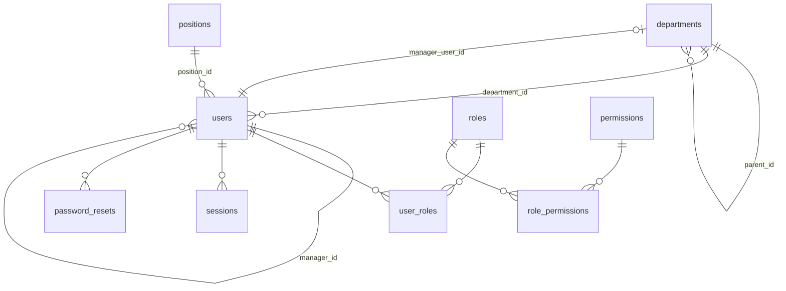

# Base de données

MySQL 8+ ou MariaDB 10.4+ · InnoDB · `utf8mb4_unicode_ci` · dates `DATETIME` en UTC · clés étrangères partout où
l'intégrité doit être garantie · requêtes préparées PDO (émulation désactivée) · mode SQL strict.

## Migrations

- Fichiers `database/migrations/NNNN_description.sql`, appliqués dans l'ordre par `php bin/console migrate`
  (ou automatiquement par l'assistant web `/install`). Les migrations appliquées sont enregistrées dans la table `migrations`.
- Pas de retour arrière automatique : MySQL valide implicitement chaque instruction DDL. **Sauvegarde obligatoire
  avant toute mise à jour** ; une erreur se corrige par une nouvelle migration.
- Séparateur d'instructions : `;` en fin de ligne. Lignes de commentaire : `--`.
- Chaque lot ajoute ses propres tables dans une nouvelle migration : le schéma n'est jamais créé « en avance » sans usage.

## Lot 1 : schéma implémenté

| Table | Rôle | Points notables |
|---|---|---|
| `settings` | Paramètres clé/valeur | `cron_last_run`, `company_name` |
| `modules` | Modules et état d'activation | Sert au tableau de bord |
| `departments` | Services (hiérarchie) | `parent_id` (cycles refusés par le service), responsable |
| `positions` | Fonctions | Intitulé unique |
| `users` | Comptes | Email unique en minuscules, `status` actif/désactivé, `must_change_password`, `deleted_at` réservé à l'anonymisation |
| `roles` | Rôles personnalisables | `is_system` = non supprimable ; `super_admin` possède toutes les permissions implicitement |
| `permissions` | Permissions atomiques `module.action` | Référentiel livré par migration |
| `user_roles`, `role_permissions` | Associations | Clés primaires composites, suppression en cascade |
| `sessions` | Sessions | `id` = SHA-256 du jeton du cookie, expiration d'inactivité et absolue contrôlée en SQL |
| `login_attempts` | Tentatives de connexion | Index (email, date) et (ip, date) pour la limitation |
| `password_resets` | Liens de réinitialisation et d'activation | Seule l'empreinte SHA-256 du jeton est stockée, usage unique |
| `audit_logs` | Journal d'audit | Pas de clé étrangère : l'historique survit à l'utilisateur |
| `mail_queue` | File d'emails | Statuts pending/sending/sent/failed, verrou optimiste, réessais |

Permissions livrées : `admin.access`, `users.view`, `users.manage`, `organization.manage`, `roles.manage`,
`sessions.manage`, `audit.view`, `settings.manage`.

## Lot 2 : annuaire et présence (migration 0003)

| Élément | Rôle |
|---|---|
| `users.phone_personal` | Téléphone personnel, visible seulement de la personne, de son responsable (hiérarchique ou du service) et des administrateurs ; `users.phone` = téléphone professionnel |
| `user_presence` | Statut déclaré du jour, une ligne au plus par personne : `status` (office, site, travel, leave, absent), `site_label`, `note`, `start_date` (jour local de la déclaration), `until_date` (≤ 90 jours), `set_by`. Valable jusqu'à `COALESCE(until_date, start_date)` inclus ; nettoyé par `cron:run` |
| `users.avatar_path` | Chemin relatif `avatars/<id>-<jeton>.webp` sous `storage/private` |
| Permission `directory.view` | Donnée à tous les rôles système |

« En ligne » n'est pas stocké : calculé depuis `sessions.last_activity_at` (moins de 5 minutes).

## Modèle prévu des lots suivants (analyse préalable)

Tables listées dans le cahier des charges, avec les décisions de modélisation prises pour éviter les redondances :

- **Messagerie** : `conversations` (type `direct|group|channel|department`, `department_id` nul sauf salon de service),
  `conversation_members` (rôle, `last_read_message_id` : un seul entier par membre remplace une ligne par message lu
  pour le compteur de non-lus), `messages` (`reply_to_id`, `edited_at`, `deleted_at`), `message_attachments`
  (chemin privé sous `storage/private`), `message_reactions` (unique message+utilisateur+emoji),
  `message_reads` réservé aux accusés de lecture des groupes (une ligne par message et lecteur, purgée après N jours),
  `user_presence` (dernière activité, saisie en cours), `chat_events` (journal d'événements pour le polling delta).
- **Calendrier** : `events` (règle de récurrence `rrule`, `calendar_type` personnel/équipe/partagé), `event_participants`
  (statut d'invitation), `event_reminders` (date d'envoi calculée, traitée par CRON).
- **Réunions** : `meetings` (liée à un `event`), `meeting_agendas`, `meeting_minutes` (compte rendu, décisions) ;
  les actions à réaliser deviennent des `tasks` liées (`meeting_id`) plutôt qu'une table dédiée.
- **Projets et tâches** : `projects`, `project_members`, `project_milestones`, `tasks` (statut, priorité, échéance,
  `project_id` facultatif, `position` pour le Kanban), `task_comments`, `task_history`. Les pièces jointes des tâches,
  des messages et des annonces partagent un service de stockage commun ; chaque module garde sa table de liaison.
- **Documents** : `document_folders`, `documents`, `document_versions` (fichier, empreinte SHA-256, taille, MIME),
  `document_permissions` (cible utilisateur, service ou rôle ; droit lecture/écriture/gestion), `document_comments`,
  corbeille par `deleted_at`.
- **Annonces** : `announcements` (`publish_at`, `expires_at`, `is_urgent`), `announcement_targets` (services ciblés),
  `announcement_reads`.
- **Workflows** : `workflow_definitions` (formulaire décrit en JSON validé), `workflow_steps` (ordre, type de validateur :
  responsable hiérarchique, rôle, service ou utilisateur), `workflow_requests` (données JSON, étape courante, statut,
  `version` pour le verrou optimiste), `workflow_history`.
- **Notifications** : `notifications` (type, charge utile JSON, `read_at`), `notification_preferences`
  (type × canal), envoi des emails par la `mail_queue` existante.

## Accès concurrents
- Transactions pour toute opération multi-tables (création de compte, réinitialisation, rôles).
- `SELECT … FOR UPDATE` sur les jetons de réinitialisation (usage unique garanti).
- `UPDATE … WHERE status = 'pending'` comme verrou optimiste de la file d'emails.
- Les workflows utiliseront une colonne `version` (verrou optimiste) pour empêcher deux validations simultanées.

## Pagination
Listes paginées côté serveur (`LIMIT`/`OFFSET`, 25 utilisateurs ou 50 entrées d'audit par page). La messagerie utilisera
une pagination par curseur (`id < ?`), plus stable et moins coûteuse.
